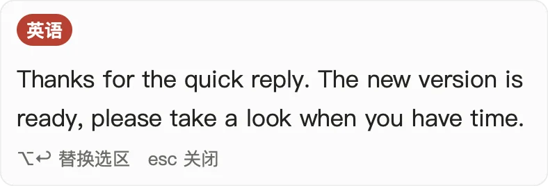
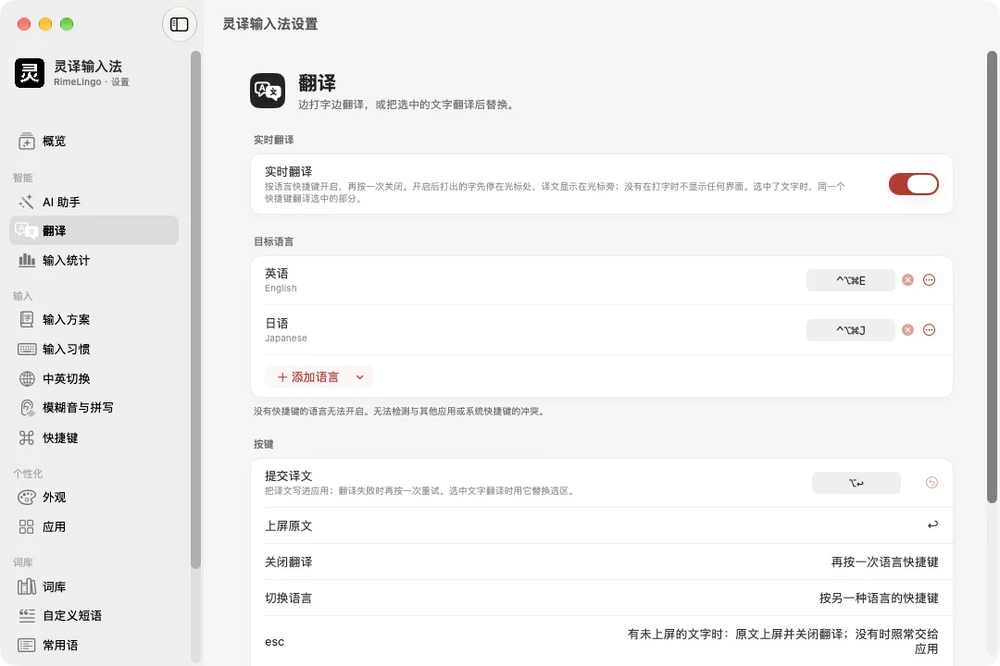
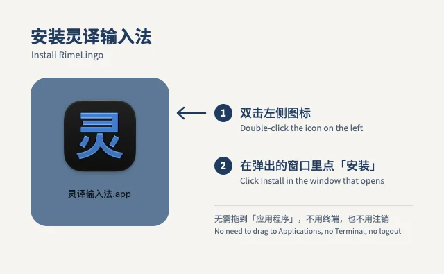

# 起因

我写东西经常要在中文、英文、日文之间来回切，习惯先用中文把意思打出来，再翻译一遍。

之前的流程很碎：打完一段中文，复制，切到翻译工具或者调出输入法的 AI 菜单，选翻译，等结果，再贴回来。每次都要打断一下思路。

我一直眼馋 Gboard 的翻译输入：边打字，翻译就在光标旁边跟着出来，满意了按一下直接上屏。Mac 上没有这个东西。我自己试过用 macOS 的快捷指令凑一个，结果键盘触发时弹出来的是个输入对话框，根本拿不到选中的文字，从菜单里点倒是能用，可那就回到原点了。

那就干脆做进输入法里。这个输入法叫 [灵译输入法 RimeLingo](https://github.com/leaker/rime-lingo)，基于开源的 [AIME](https://github.com/zoolapp/aime) 改出来，输入引擎是 [RIME](https://rime.im)，日常拼音输入这一块沿用了它们的成果。

# 打字时翻译

在任意输入框里按 `⌃⌥⌘E`（译成英文）或者 `⌃⌥⌘J`（译成日文），打开实时翻译。之后照常打中文，翻译会出现在光标旁边，你继续改，它跟着变。


满意了按 `⌥↩`，把翻译上屏；想要中文原文就按 `↩`。翻译失败的话再按一次 `⌥↩` 重试。

整个过程没有按钮，全靠键盘。没在打字的时候，翻译窗口不会出现，也不会挡视线。

有两个小细节我自己很在意：

- 翻译没上屏之前，中文还能接着改，方向键移光标、插入、删除都行，译文跟着更新
- 关掉实时翻译的时候，还没上屏的中文会先写进输入框，不会丢

# 选中文字翻译

已经写好的内容也一样。在聊天框、文档或者编辑器里选中一段，按同样的语言快捷键，译文出来后按 `⌥↩` 直接替换选区，`Esc` 取消。



只读内容里的选区（网页正文、PDF）读不到，这个做不了。

# 翻译从哪来

默认用 macOS 自带的本机翻译，需要系统开着 Apple 智能，文字不出你的 Mac。

不想用的话，也可以在设置的「AI 助手」里填一个兼容 OpenAI API 的在线服务，地址和 key 自己填。这时待翻译的文字才会发到你填的那个地址，而且要在设置里单独点一下允许发送，默认不会。

目标语言不限于英文和日文。设置的「翻译」页里可以加别的语言，每种单独配一个快捷键。



# 其他

平时的拼音输入、双拼、模糊音、词库、候选窗外观这些，沿用 AIME 的设置，都在同一个设置应用里。快捷菜单把 AI 动作、短语、符号、emoji 收在一处。


如果你用的是鼠须管，设置的「概览」页有个「导入」，可以把原来的方案和自定义配置带过来，不会动 `~/Library/Rime`。

密码框里它什么都不做，按键直接交给系统，不弹候选窗，也不触发翻译。这条我是认真对待的：之前用 AIME 的时候，锁屏界面连着几次输对了密码都被拒，翻系统日志，当时输入法确实在处理锁屏密码框里的每一次按键。灵译我也核对过锁屏解锁：在系统保留 ABC 输入源的情况下，第一次就解开了，日志里它没收到按键。输入源里完全没有 ABC 的那种配置，我没法用正常手段构造出来，所以密码框直通这条路径本身没测到。

# 安装

要求 macOS 15 及以上、Apple 芯片的 Mac。

从 [Releases](https://github.com/leaker/rime-lingo/releases/latest) 下 `.dmg`，双击打开，再双击里面的 app，点「安装」。



它会把输入法装进你自己的 `~/Library/Input Methods`，并自动启用，不要管理员密码，不用注销。之后的新版本每天检查一次，校验签名后趁 Mac 空闲时自己装，不用重复这些步骤。

首次安装有个坑：系统里负责拉起输入法的进程从登录起就一直在跑，它不认识刚装的新输入法，于是能选中，但中英文都打不出来。系统日志里能看到：

```text
imklaunchagent: LaunchInputMethod() Error, status=-50
```

注销再登录一次，或者执行下面这行就好：

```bash
killall imklaunchagent TextInputMenuAgent TextInputSwitcher
```

装完在菜单栏的输入法列表里选「灵译输入法」（系统首选语言里有英文且简体中文不在它前面时，显示为 RimeLingo），或者直接按 `⌃Space`。

# 最后

代码在 [github.com/leaker/rime-lingo](https://github.com/leaker/rime-lingo)，MIT。网站在 [rimelingo.keworks.dev](https://rimelingo.keworks.dev/)。设置界面目前只有中文。

最初只是想少复制几次，现在翻译这件事基本不用离开输入框了。
